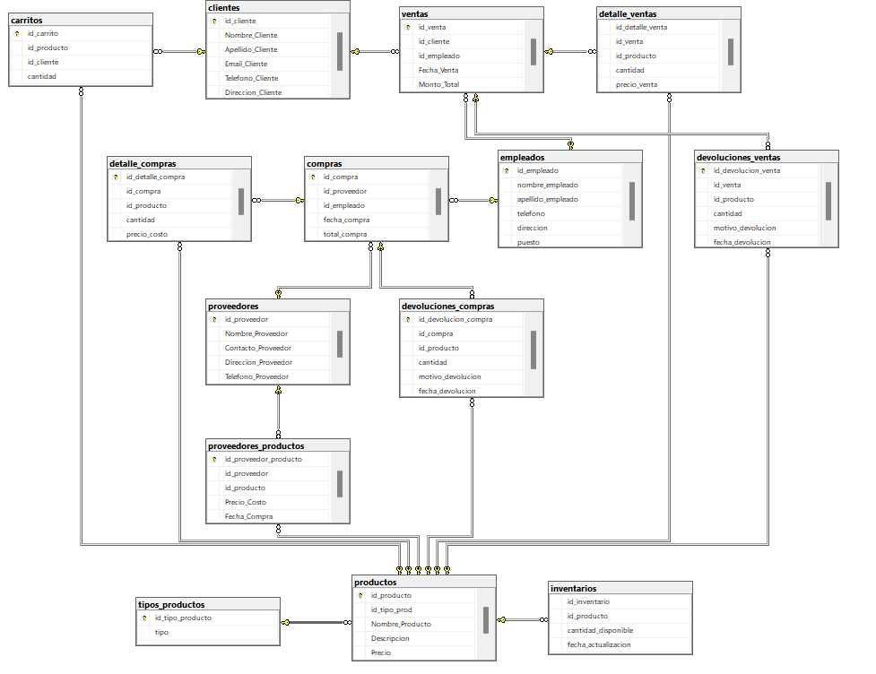

# 🍷 Vinatería "El Corcho" — Base de datos relacional y NoSQL

Diseño e implementación de la base de datos de una vinatería con tienda en línea, con un carrito de compras por cliente. El mismo dominio se modeló de dos formas:

- **PostgreSQL**: modelo relacional y lógica de negocio en funciones y procedimientos PL/pgSQL que garantizan la integridad de compras, ventas, devoluciones e inventario.
- **MongoDB**: colecciones con validación por JSON Schema y documentos embebidos, con datos de prueba.

> Proyecto en equipo de la materia de Bases de Datos (otoño 2024).

## 🗺️ Modelo relacional

16 tablas que cubren catálogo (`productos`, `tipos_productos`, `inventarios`), abastecimiento (`proveedores`, `proveedores_productos`, `compras`, `detalle_compras`, `devoluciones_compras`), ventas (`clientes`, `carritos`, `ventas`, `detalle_ventas`, `devoluciones_ventas`) y personal (`empleados`).

## ⚙️ Lógica de negocio en PostgreSQL

| Archivo | Flujo | Funciones y procedimientos |
|---|---|---|
| [`ventas-desde-carrito.sql`](postgresql/ventas-desde-carrito.sql) | Convertir el carrito de un cliente en una venta | `verificar_cliente_empleado`, `crear_venta`, `procesar_carrito`, `vaciar_carrito`, procedimiento `generar_venta` |
| [`compras-a-proveedores.sql`](postgresql/compras-a-proveedores.sql) | Registrar una compra validando que el proveedor surta cada producto | `existencia_proveedor`, `verdificar_detalles_carrito`, `realizar_compra`, `insertar_detalles`, `procesar_compra` |
| [`devoluciones-de-ventas.sql`](postgresql/devoluciones-de-ventas.sql) | Registrar una devolución y regresar el producto al inventario con historial | `actualizar_inventario`, tabla `historial_inventario`, procedimiento `procesar_devolucion_venta` |

Todos los flujos validan primero que existan las entidades involucradas (cliente, empleado, proveedor, producto). Si algo no cuadra, abortan con `RAISE EXCEPTION`, de modo que no quedan registros inconsistentes.

## 🍃 Versión en MongoDB

- [`colecciones-con-validacion.mongodb`](mongodb/colecciones-con-validacion.mongodb) crea las colecciones con `$jsonSchema`: campos requeridos, tipos, rangos, longitudes y patrones (por ejemplo, teléfono de 10 dígitos). Datos como inventario o tipo de producto van **embebidos** en el documento en lugar de ir en tablas separadas.
- [`mongodb/datos/`](mongodb/datos) contiene los registros de prueba de cada colección.

Los archivos `.mongodb` se pueden ejecutar desde el *playground* de la extensión de MongoDB para VS Code.

## 👥 Equipo

Proyecto desarrollado en equipo. El historial de commits conserva la autoría de cada integrante.

- **David Melgoza** ([@D3vo1](https://github.com/D3vo1)): flujo de devoluciones de ventas y actualización de inventario con historial (`devoluciones-de-ventas.sql`).
- **Luis Gabriel López Vega** ([@Gabooo09](https://github.com/Gabooo09)): ventas desde carrito, modelo relacional y versión en MongoDB.
- **Jesús Daniel Méndez Moreno** ([@DanielMM200](https://github.com/DanielMM200)): compras a proveedores.

Repositorio original: [Gabooo09/Vinateria](https://github.com/Gabooo09/Vinateria).

## 🛠️ Tecnologías

PostgreSQL · PL/pgSQL · MongoDB · JSON Schema · Modelado entidad-relación
